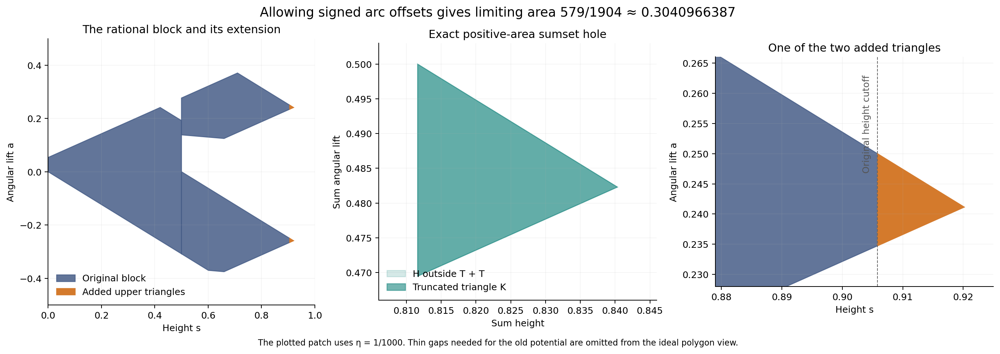

# Erdős 142: construction results from the second research round

**The requested ratio-one asymptotic remains unsolved.** This directory contains a completed Lean lower-bound theorem for the exact upstream extremal function and a stronger ordinary mathematical construction.

## Main results

Let $r_3(N)$ be the maximum size of a three-term-progression-free subset of $\{1,\ldots,N\}$. All logarithms below are natural.

1. **Complete Lean theorem.** For every
   $$
   C>2\sqrt{\log(10/3)}=2.194513890888765\ldots,
   $$
   eventually $r_3(N)\ge N\exp(-C\sqrt{\log N})$.
   The theorem is stated directly for the upstream function
   Set.IsAPOfLengthFree.maxCard 3 N, definitionally Erdos142.r 3 N.

2. **Stronger ordinary proof.** The signed six-width construction gives finite bounded-potential torus blocks with areas arbitrarily close to
   $$
   E_*=\frac{17-6\sqrt2}{28}=0.304097093777193918\ldots.
   $$
   Consequently the same eventual lower bound holds for every
   $$
   C>2\sqrt{\log\!\left(\frac{28}{17-6\sqrt2}\right)}
     =2.182116624879836\ldots.
   $$
   This stronger density has an ordinary proof and exact rational/symbolic audits. It has **not** been assembled into the completed Lean chain.

The crucial change is to permit signed offsets from the upper arc centers. Their actual interval lengths remain positive. Continuing those arcs beyond an unnecessary old cutoff adds two triangles, equivalent to two upper doubling preimages of a triangular hole in the old torus sumset. A simple rational parameter choice gives the limiting area $579/1904$.

## Start here

- [RESULT.md](RESULT.md): self-contained result, construction, proof mechanism, exact optimization, and limitations.
- [signed-six-width-continuation.md](signed-six-width-continuation.md): complete stronger ordinary proof.
- [formal/CombinedLowerBound.lean](formal/CombinedLowerBound.lean): final kernel-checked theorem.
- [REPLAY.md](REPLAY.md), [DEPENDENCIES.json](DEPENDENCIES.json), and [replay_formal.py](replay_formal.py): pinned reproduction instructions.
- [verification.json](verification.json): successful fresh build of 19 modules with 48 axiom audits.
- [ATTRIBUTION.md](ATTRIBUTION.md): exact credit and changes to the external proof on which the transfer builds.

The figure depicts ideal polygon regions. Positive finite-layer gaps are omitted in the picture and retained in every actual bounded-potential certificate.

## Verification status

The fresh isolated replay passed on 28 November 2026 using Lean 4.33.1, with warnings treated as errors. It rebuilt the upstream AP.Basic source and all 18 local modules from source in a new directory, reusing only the installed dependency cache. All 48 printed theorem audits use at most propext, Classical.choice, and Quot.sound. No placeholder theorem from the problem file is imported.

The exact rational geometry checks cover the whole continuous height-pair domain by a line-arrangement vertex argument. The signed rational benchmark passes 207 inequalities and has area $579/1904$. A separate polygon verifier passes 60 periodic Minkowski exclusions across four rational examples. Direct symbolic integration verifies both the signed area expression and its square decomposition. Floating-point optimization is exploratory evidence only.

## Other research files

- [six-width-geometry.md](six-width-geometry.md): finite-layer midpoint exclusions and quadratic potential, including the folded upper midpoint case.
- [six-width-analytic-benchmark.md](six-width-analytic-benchmark.md): the earlier unsigned family and the improvement over shared note 110197.
- [torus-hole-augmentation.md](torus-hole-augmentation.md): independent hole-extension proofs, including the stronger one-half addition.
- [triangle-hole-potential-extension.md](triangle-hole-potential-extension.md): the earlier one-seventh extension; valid but superseded numerically.
- [verify_signed_six_width.py](verify_signed_six_width.py) and [signed-continuous-certificates.json](signed-continuous-certificates.json): exact signed-profile audit.
- [derive_signed_six_width.py](derive_signed_six_width.py): direct symbolic integration and square identity.
- [verify_augmentations.py](verify_augmentations.py) and [augmentation-certificates.json](augmentation-certificates.json): independent exact polygon geometry.
- [exact_six_width.py](exact_six_width.py) and [exact-six-width-step-profiles.json](exact-six-width-step-profiles.json): finite rational step profiles.
- [nonuniform_signed_lp.py](nonuniform_signed_lp.py) and [nonuniform-signed-lp-results.json](nonuniform-signed-lp-results.json): broader numerical search, without a global optimality claim.

The published EHPS framework and its $7/24$ block are credited in the proofs. The finite-field transfer adapts 555tery's pinned source and was independently replayed. The six-width starting family came from a shared working note. Overall novelty or publication priority is not established by this session.

The final result was successfully stored and read back as Left to Solve note **#136918**. Earlier intermediate note requests failed during database outages. [COORDINATION.md](COORDINATION.md) records the exact source checkpoint, successful handoff, and released lease. No full-problem solution was submitted.
