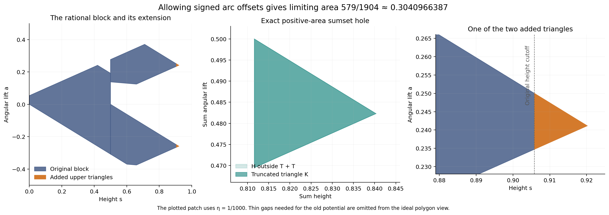

# Erdős 142: an improved construction and a completed formal lower bound

Research date: 28 November 2026.

**The full Erdős 142 problem remains unsolved.** The additional research produced a stronger explicit construction for three-term-progression-free sets, together with a complete Lean proof of a conservative numerical version. These are substantive lower-bound results. They do not identify a function asymptotic to the extremal function with relative error tending to zero.

## 1. The results and their verification levels

Write

$$
r_3(N)=\max\{|A|:A\subseteq\{1,\ldots,N\},
\ A\text{ contains no nontrivial three-term arithmetic progression}\}.
$$

All logarithms in this report are natural. The two results are:

**Theorem A — complete Lean chain.** For every real

$$
C>2\sqrt{\log(10/3)}
=2.194513890888765\ldots,
$$

there exists an integer $N_0$ such that

$$
r_3(N)\ge N\exp(-C\sqrt{\log N})
\qquad(N\ge N_0).
$$

The theorem is stated directly for Set.IsAPOfLengthFree.maxCard 3 N, definitionally the function Erdos142.r 3 N in the upstream problem. It does not import that problem's unresolved placeholders. A fresh isolated replay passed all 19 modules and 48 axiom audits.

**Theorem B — stronger ordinary construction.** For every real

$$
C>C_*:=
2\sqrt{\log\!\left(\frac{28}{17-6\sqrt2}\right)}
=2.182116624879836\ldots,
$$

the same eventual lower bound holds. Its geometric input is a family of finite bounded-potential torus blocks with areas approaching

$$
E_*=\frac{17-6\sqrt2}{28}
=0.304097093777193918\ldots.
$$

Theorem B has a written mathematical proof, an independent audit of the signed geometry, exact rational checks covering continuous height-pair domains, and direct symbolic integration. The entire larger-density construction is **not yet formalized in Lean**. Some of its signed exclusion lemmas have been separately kernel checked.

| Construction | Block density or limiting area | Coefficient threshold $2\sqrt{\log(1/\rho)}$ | Status here |
|---|---:|---:|---|
| Published EHPS construction | $7/24$ | $2.220039352167\ldots$ | Published benchmark |
| Conservative finite construction in this round | $3/10$ | $2.194513890889\ldots$ | Complete Lean theorem |
| Signed continuation in this round | $(17-6\sqrt2)/28$ | $2.182116624880\ldots$ | Ordinary proof and exact audits |

A smaller coefficient gives a larger eventual lower bound. The published benchmark is from Elsholtz, Hunter, Proske, and Sauermann, [Improving Behrend's construction: Sets without arithmetic progressions in integers and over finite fields](https://arxiv.org/abs/2406.12290). Their two-dimensional block framework connects the available area with this leading exponential coefficient.

## 2. The geometric change

We use coordinates $(s,a)$ on the two-dimensional torus, with height $s\in(0,1)$ and angular lift $a\in(-1/2,1/2)$. A lower-height slice has one interval; an upper-height slice has two intervals.

For $0<s<1/2$, define

$$
L(s)=ps,\qquad W(s)=\min(w+qs,1-ps),
$$

and take the angular interval

$$
A(s)=(-L(s)/2,W(s)/2).
$$

For upper height $s=1/2+t$, define

$$
\begin{aligned}
U(t)&=1-2pt,\\
P_0(t)&=2w+q-1+2qt,&P(t)&=\min(U(t),P_0(t)),\\
V_1(t)&=1-2w-2qt,&
V_0(t)&=(2-U(t)-P_0(t))/2,\\
V(t)&=\min(V_1(t),V_0(t)),\\
M_0(t)&=p-1+2pt,&M(t)&=\min(V(t),M_0(t)).
\end{aligned}
$$

The two angular intervals are

$$
B^+(t)=(1/4-V(t)/4,1/4+P(t)/4),
$$

$$
B^-(t)=(-1/4-M(t)/4,-1/4+U(t)/4).
$$

The earlier nonnegative-offset version stopped at

$$
b=\frac1{2p},
$$

where $U$ becomes zero. However, $P$ and $U$ are offsets from chosen centers, not the lengths of the intervals. The actual interval lengths are $(P+V)/4$ and $(M+U)/4$.

Continue instead to

$$
h=\frac{1-w}{p+q}.
$$

In the extra strip $b<t<h$, the profiles simplify to

$$
P=U=1-2pt<0,\qquad V=M=1-2w-2qt>0,
$$

while

$$
P+V=M+U=2(p+q)(h-t)>0.
$$

The two intervals remain nonempty. They move away from their nominal centers and shrink to points at $t=h$. The extra strip contributes

$$
\int_b^h(p+q)(h-t)\,dt
=\frac{p+q}{2}(h-b)^2.
$$

Equivalently, the old block's torus sumset has a triangular hole

$$
H=\{(s,a):2b<s<2h,\quad w+qs/2<a<1-ps/2\}.
$$

Its area is $(p+q)(h-b)^2$. The two upper doubling preimages of almost all this hole supply the extra area approaching $|H|/2$. The signed-profile proof and the hole-extension proof provide two views of the same improvement.

The plot uses rational parameters and a positive truncation of the added triangles. It depicts ideal polygon regions; finite-layer gaps, required by the potential proof, are omitted from the picture.

## 3. Why the midpoint argument survives

A large region is useful only if its arithmetic progressions satisfy the needed convexity inequality. The proof tracks every modular midpoint case.

For an upper slice define

$$
R=\max(P,U),\qquad S=\max(V,M).
$$

The doubled angular midpoint slices avoid the central interval

$$
(-1/2+R/2,\ 1/2-S/2)
$$

modulo integers. For lower endpoint heights $a,c$, the only possible upward upper midpoint has offset $t=(a+c)/2$. It is excluded by

$$
L(a)+L(c)+R(t)\le1,\qquad
W(a)+W(c)+S(t)\le1.
$$

For a lower endpoint at height $a$ and an upper endpoint at offset $c$, an upward upper midpoint has offset $t=1/4+(a+c)/2$. The two needed inequalities are

$$
P(c)+2W(a)+2S(t)\le1,
$$

$$
M(c)+2L(a)+2R(t)\le1.
$$

These inequalities remain sufficient for signed parameters in $[-1,1]$, provided actual interval lengths are nonnegative. The auxiliary bounds in the mixed case use only $V-M\le2$ and $U-P\le2$, which the signed caps guarantee. Two upper endpoints cannot have an upward height midpoint in $(0,1)$.

For the displayed profiles, $R=U$ and $S=V$. The lower/lower bounds follow from linearity of $L$, concavity of $W$, and the affine definitions of $U,V_1$. In the mixed case, the height restriction forces $a<h$, so $W(a)=w+qa$. The exact affine identities are

$$
P_0(c)+2W(a)+2V_1(t)=1,
$$

$$
M_0(c)+2L(a)+2U(t)=1.
$$

Taking the specified minima preserves both inequalities.

The local angular potential uses $u=a$ in lower slices. In upper slices use $u=a-1/2$ on $B^+$ and $u=a$ on $B^-$. Both folded arcs lie in $(-1/2,0)$. Same-label endpoint pairs have ordinary folded midpoints. Different-label pairs can have folded discrepancy $-1/2$; this case is allowed and supplies extra positive curvature. The alternative discrepancy $+1/2$ is excluded by

$$
P+U+2V\le2,\qquad P+U+2M\le2.
$$

The result is the angular inequality needed by the full potential. It is a mistake to discard the permitted $-1/2$ case or to assume that every surviving midpoint is ordinary.

## 4. Why finite layers and positive gaps matter

The continuous profile determines an area supremum. To obtain a valid bounded-potential certificate, first truncate at $h-\eta$ for a fixed $\eta>0$. Approximate the six Lipschitz profiles from inside by constants on finitely many height cells. For sufficiently fine cells, the retained actual intervals still have positive length.

Each exclusion inequality has nonnegative coefficients in the width parameters. Taking cellwise infima therefore preserves all exclusions at every real height pair. Trim a positive amount from each retained cell so that distinct cells are separated by a fixed $g>0$.

For this fixed finite construction, take

$$
F(s,a)=K s^2+4u^2,\qquad K\ge2+\frac6{g^2}.
$$

The same-cell angular analysis handles ordinary vertical midpoints. Distinct cells have height separation at least $g$, so the height quadratic pays for the worst possible angular loss. Downward height wrap has positive quadratic curvature at least $1/2$. Upward wrap was excluded above. Together these prove

$$
F(x)+F(z)-2F(y)\ge
(s_x-s_z)^2+(a_x-a_z)^2
$$

for every torus arithmetic progression $x+z=2y$ in the block, using the prescribed real lifts. The potential is nonnegative and bounded by $K+1$.

For each desired area $\rho<E_*$, choose a sufficiently close rational parameter triple, a small positive truncation, a fine finite mesh, and small positive gaps. Then fix those choices. The resulting block has area greater than $\rho$ and one finite potential bound, independent of the later prime grid.

Thus the argument does not put a zero gap or an infinite potential into a certificate. The potential bound can grow as $\rho$ approaches $E_*$; this does not change the leading coefficient for any fixed strict $C>C_*$.

## 5. Exact integration and optimization

In the relevant open switching regime, direct integration gives

$$
E(p,q,w)=-
\frac{
4p^2+4pq+8pw-24p+5q^2+4qw-24q+
12w^2-16w+16
}{32(p+q)}.
$$

Put $r=p+q>0$. The key exact identity is

$$
\begin{aligned}
E(p,q,w)
={}&\frac{17-6\sqrt2}{28}
-\frac{(\sqrt2\,r-3)^2}{28r}\\
&-\frac{(7q-2r-2)^2}{336r}
-\frac{(2p+q+6w-4)^2}{96r}.
\end{aligned}
$$

Every subtracted term is nonnegative. Equality holds at

$$
p=\frac{15\sqrt2-4}{14},\qquad
q=\frac{3\sqrt2+2}{7},\qquad
w=\frac{5-3\sqrt2}{7}.
$$

These parameters satisfy the needed strict switching order

$$
0<m<v<c<b<h<1/2,
$$

where

$$
m=\frac{2-p-q/2-w}{p+q},\quad
v=\frac{q/2-w}{p+q},\quad
c=\frac{1-q/2-w}{p+q}.
$$

This proves the exact optimum within this analytic switching regime. It is not an upper bound for every possible torus construction.

The simple rational choice

$$
p=\frac{69}{56},\qquad q=\frac{25}{28},\qquad w=\frac3{28}
$$

has exact area

$$
E=\frac{579}{1904}=0.30409663865546216\ldots.
$$

An independent Fraction-only verifier checks the piecewise-affine inequalities on the vertices of their full line arrangement. This covers the entire continuous domain, rather than sampled midpoint pairs. The rational benchmark passes 207 exact inequalities. A separate polygon audit checks periodic Minkowski sums, the hole, and its preimages. Direct symbolic integration independently recovers both the area formula and the square identity.

## 6. Transfer to integer progression-free sets

Intersect a fixed rational block with the $1/\ell$ grid, where $\ell$ runs over large primes. Finite unions of rational rectangles have normalized grid counts converging to their areas. Hence every sufficiently large prime has a finite block of density at least $\rho$ with the same potential bound.

The generic transfer tensors the block, selects a thin potential shell, controls the short differences of any surviving progression, and selects an affine map back to an integer interval. In the checked analytic estimate, the principal exponential loss is

$$
m\log(1/\rho)+\frac{\log N}{m}.
$$

Choosing $m$ close to

$$
\sqrt{\frac{\log N}{\log(1/\rho)}}
$$

makes this loss

$$
2\sqrt{\log(1/\rho)\log N}+O(1).
$$

The fixed potential bound and shell losses contribute lower-order factors, absorbed by every strict increase in the coefficient. Thus

$$
r_3(N)\ge N\exp(-C\sqrt{\log N})
$$

eventually for each $C>2\sqrt{\log(1/\rho)}$. For a given $C>C_*$, select one $\rho<E_*$ close enough and apply this theorem.

The transfer machinery adapts [555tery's pinned proof](https://github.com/555tery/quandle-orbit-series/blob/21274b81d4fec2b0e344940ae053c925410dbacf/lean/QuandleResearch/Proofs/Erdos142/Geometry.lean), independently replayed here. The exact credit, source hashes, compatibility edit, and C58 metadata's license declaration appear in [ATTRIBUTION.md](ATTRIBUTION.md).

## 7. What the completed Lean chain certifies

The formal density instantiation uses a 192-step height grid, 96 lower cells and 80 upper cells, with exact rational widths. Its vertical gaps are $10^{-6}$. The potential coefficient is $6000000000002$, and the potential bound is $6000000000003$.

The finite-grid proof counts a horizontal microcell family of size 1,034,322 and 31,244 retained microcell rows per height layer. It counts the product symbolically; it does not enumerate billions of cells. For every prime at least 60,000,000,000, this yields a certified density of at least $3/10$.

The checked chain includes:

- Exact modular integer cases and height-cell separation.
- All angular Jensen cases and upward midpoint exclusions.
- Exact rational feasibility of the finite profile.
- Rectangle-grid counting and the uniform density theorem.
- Tensor, shell, slope, and asymptotic transfers.
- The bridge from Mathlib's Roth number to the exact upstream maximum.
- The final eventual bound and strict comparison with the EHPS coefficient.

The fresh rebuild used Lean 4.33.1 with warnings as errors. It rebuilt AP.Basic plus 18 local modules in a new directory. All 48 axiom-audit entries use at most propext, Classical.choice, and Quot.sound. The final source and full report are [CombinedLowerBound.lean](formal/CombinedLowerBound.lean) and [verification.json](verification.json).

## 8. Search limits and the unresolved part

The second round moved away from the initial structural-regularity route. That route had produced conditional information about extremizers and a countermodel showing why its listed estimates could not determine the amplitude. The construction round instead attacked the lower bound directly.

The exploration also rejected apparent holes in a rasterized symmetric block: those features disappeared under resolution changes and failed exact geometric scrutiny. The triangular hole used in the final result has an exact description and exact polygon checks.

A broader signed-width numerical LP, including a nonuniform refinement with 208 variables and 12,472 constraints, did not exceed $E_*$ in the tested class. This is evidence about that search space, not a global optimality theorem.

The remaining full problem is much harder than optimizing this construction. It asks for an explicit asymptotic equivalent to $r_k(N)$, with ratio tending to one. No matching upper bound was obtained. A recent upper-bound theorem for $r_3$ has the form

$$
r_3(N)\le N\exp\!\left[
-\Omega\!\left(
\left(\frac{\log N}{\log\log N}\right)^{1/6}
\right)
\right],
$$

as stated in Theorem 1.4 of Raghavan's [Improved Bounds for 3-Progressions, version 3](https://arxiv.org/html/2603.27045v3). This remains far from the square-root-logarithm lower-bound scale. Even a matching leading coefficient would leave a stronger ratio-one question.

No solution declaration or full-problem pull request is justified by these results. The construction and formal certificate are preserved so that subsequent work can build on exact statements rather than rediscovering the same profiles or relying on unverified numerical claims.
